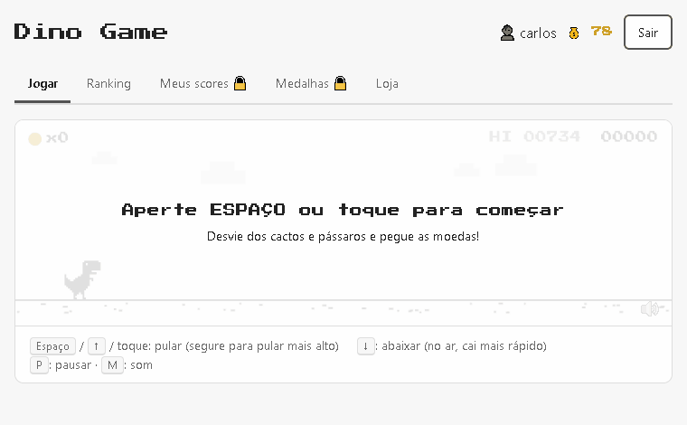

# Projeto: Dino Game com cadastro, autenticação, medalhas e skins

<!-- TODO (Carlos): gravar um GIF novo do Projeto 3 (ex.: com ScreenToGif) e substituir o demo.gif -->


## Acesso

<!-- TODO (Carlos): colar a URL do Render aqui e na seção "About" do repositório -->
**https://SEU-APP.onrender.com**

## Desenvolvedor(a)

Carlos Henrique Mendina Gonçalves Pereira — Engenharia de Computação

## Proposta

Melhorar o jogo do Projeto 2, graficamente e logicamente, deixando-o com uma progressão e experiência
mais agradável ao jogador (essa etapa seria importante para justificar as novas funcionalidades dos
usuários descritas a seguir). Sugestão: deixar essa etapa para depois da estruturação do backend.

Implementar cadastro e autenticação do usuário, que permite salvar, ver e administrar suas pontuações no
ranking global. Medalhas mensais e anuais, disponíveis para a visualização em uma sessão acessível apenas
por usuários autenticados. Implementar um sistema básico de skins com compras utilizando créditos do jogo.

Frontend: manter a tecnologia utilizada no Projeto 2. Backend: Render (PostgreSQL), sem blueprints,
estudando a utilização do Docker.

### O que foi entregue

| Funcionalidade | Acesso |
|---|---|
| Jogar (com progressão de dificuldade, moedas, pássaros, ciclo dia/noite, sons) | qualquer pessoa |
| Ranking global (melhor score de cada jogador) | qualquer pessoa |
| Cadastro, login e logout | qualquer pessoa |
| Salvar score ao fim da partida (gera créditos) | **somente autenticado** |
| Meus scores: ver e apagar as próprias pontuações | **somente autenticado, só as suas** |
| Medalhas mensais e anuais (top 3 de cada período) | **somente autenticado** |
| Loja: comprar skins com créditos e escolher a skin em uso | **somente autenticado, só skins compradas** |

## Desenvolvimento

### Processo

<!-- TODO (Carlos): o template pede esta seção em PRIMEIRA PESSOA e SEM AJUDA DE IA.
     Material de apoio para lembrar o que aconteceu: ESTUDO.md (diário com cada passo, quem fez o quê
     e os problemas encontrados). -->

*(a ser escrito por mim)*

O registro detalhado de cada passo, com conceitos, comandos, problemas encontrados e autoria
(✍️ feito por mim / 🤖 feito pela IA), está em **[ESTUDO.md](./ESTUDO.md)**. A governança do uso de
IA neste projeto está em [CLAUDE.md](./CLAUDE.md) e [.claude/skills/mentor/SKILL.md](./.claude/skills/mentor/SKILL.md).

### Trechos de código

**1. O "porteiro" das rotas protegidas** — [auth.js](./auth.js)

```js
function requireAuth(req, res, next) {
  const header = req.headers.authorization || '';
  const [type, token] = header.split(' ');
  if (type !== 'Bearer' || !token) {
    return res.status(401).json({ error: 'Faca login para acessar' });
  }
  try {
    req.user = jwt.verify(token, process.env.JWT_SECRET);
    next();
  } catch (error) {
    return res.status(401).json({ error: 'Sessao invalida ou expirada. Faca login de novo' });
  }
}
```

Esse *middleware* roda antes de toda rota protegida. Sem token, ou com um token alterado/expirado, ele
responde **401** e a rota nem executa. Por isso as abas "Meus scores" e "Medalhas" não são escondidas no
frontend: elas sempre pedem os dados ao servidor e mostram o *"Acesso negado pelo servidor (HTTP 401)"*
que recebem. Quem protege é o backend, não a tela.

**2. Autorização: só o dono apaga o próprio score** — [server.js](./server.js)

```js
app.delete('/api/scores/:id', requireAuth, async (req, res) => {
  const result = await pool.query(
    'DELETE FROM scores WHERE id = $1 AND user_id = $2',
    [req.params.id, req.user.id]
  );
  if (result.rowCount === 0) {
    return res.status(404).json({ error: 'Score nao encontrado entre os seus' });
  }
  res.status(204).end();
});
```

O id do usuário vem **do token** (`req.user.id`), nunca do que o navegador envia. Se alguém tentar apagar
o score de outra pessoa, o `AND user_id = $2` faz o `DELETE` afetar zero linhas, e a resposta é 404.
O teste automático *"Bob não consegue apagar o score da Alice"* comprova isso.

**3. Medalhas calculadas com uma consulta SQL** — [server.js](./server.js)

```sql
WITH best AS (
  SELECT to_char(s.created_at AT TIME ZONE 'America/Sao_Paulo', $1) AS period,
         u.id AS user_id, u.username, MAX(s.score) AS best_score
  FROM scores s JOIN users u ON u.id = s.user_id
  GROUP BY period, u.id
),
ranked AS (
  SELECT *, RANK() OVER (PARTITION BY period ORDER BY best_score DESC)::int AS position
  FROM best
)
SELECT period, username, best_score, position, (user_id = $2) AS is_me
FROM ranked WHERE position <= 3
ORDER BY period DESC, position
```

Não existe tarefa agendada distribuindo medalhas: a consulta calcula o pódio de cada período na hora.
A mesma consulta serve para mensal (`$1 = 'YYYY-MM'`) e anual (`$1 = 'YYYY'`). O horário é convertido
para o fuso de Brasília antes de decidir o mês, porque o banco guarda tudo em UTC.

**4. Jogo independente da frequência do monitor** — [public/game.js](./public/game.js)

```js
function frame(now) {
  const dt = Math.min((now - lastTime) / 1000, MAX_DT);
  lastTime = now;
  if (state === 'playing') update(dt);
  ...
}
// no update:
dino.bottom += dino.vy * dt + 0.5 * gravity * dt * dt;   // s = v·t + ½·a·t²
dino.vy += gravity * dt;
obstacles.forEach((o) => (o.x -= speed * dt));            // speed em px/s
```

No Projeto 2, tudo andava "pixels por quadro", e num monitor de 144 Hz o jogo ficava 2,4× mais rápido.
Agora tudo é "pixels por segundo" multiplicado pelo `dt` (tempo desde o último quadro). Medindo o pulo, a
altura ficou em 129,3 px em 60, 144 e 240 Hz.

## Tecnologias

### Linguagens e afins

- JavaScript: frontend (HTML5 Canvas, Web Audio API) e backend (Node.js)
- HTML5 e CSS3 (sem frameworks, como no Projeto 2)
- Node.js + Express 5 (servidor web e API REST)
- PostgreSQL 16, acessado com a biblioteca `pg` (SQL escrito à mão, sem ORM)
  - transações (`BEGIN`/`COMMIT`/`ROLLBACK`) e `SELECT ... FOR UPDATE` na compra de skins
  - chaves estrangeiras, `unique`, `check` e índices
  - função de janela `RANK() OVER (PARTITION BY ...)` para as medalhas
- `bcryptjs` (hash de senhas) e `jsonwebtoken` (tokens JWT)
- `dotenv` (variáveis de ambiente)
- Docker + Docker Compose (PostgreSQL local para desenvolvimento)
- Render: Web Service (Node) + PostgreSQL, configurados manualmente pelo painel (sem blueprints)
- `node:test` (testes automáticos da API, sem dependências extras)

### Autenticação e autorização

- **Cadastro:** `POST /api/register` valida usuário (3 a 20 letras, números ou `_`) e senha (6 a 72
  caracteres) e salva apenas o **hash bcrypt** da senha (custo 10). Nome repetido é recusado pelo
  `unique` do banco (409).
- **Login:** `POST /api/login` compara a senha com `bcrypt.compare` e devolve um **token JWT** assinado
  com o `JWT_SECRET` (variável de ambiente), contendo `id` e `username`, com validade de 7 dias. A
  mensagem de erro é a mesma para usuário inexistente e senha errada.
- **Token (stateless):** o navegador guarda o token no `localStorage` e o envia em todo pedido no
  cabeçalho `Authorization: Bearer <token>`. O servidor não guarda sessão.
- **Logout:** o navegador apaga o token. Sem ele, as rotas protegidas respondem 401.
- **Autenticação no backend:** o middleware `requireAuth` verifica o token antes de toda rota protegida
  (401 se ausente, inválido ou expirado).
- **Autorização no backend:**
  - o id do usuário vem sempre do token, nunca do corpo do pedido;
  - consultas filtradas por dono (`WHERE user_id = $1`) para listar e apagar scores (apagar o de outro → 404);
  - equipar skin só se for grátis ou comprada (403);
  - comprar só com créditos suficientes, dentro de uma transação (400 / 409).
- **Testes de acesso:** [tests/api.test.js](./tests/api.test.js) tem 16 testes de acessos permitidos e
  **não permitidos** (sem token, token falsificado, usuário mexendo em dado de outro, compra sem créditos
  etc.). Para rodar: `npm test` (servidor ligado); contra o site publicado:
  `$env:BASE_URL="https://SEU-APP.onrender.com"; npm test`.

| Rota | Acesso |
|---|---|
| `POST /api/register`, `POST /api/login` | pública |
| `GET /api/scores` (ranking), `GET /api/skins` (catálogo) | pública |
| `GET /api/me`, `POST /api/scores`, `GET /api/me/scores` | autenticado |
| `DELETE /api/scores/:id` | autenticado + dono do score |
| `GET /api/medals` | autenticado |
| `POST /api/skins/:id/buy`, `PUT /api/me/skin` | autenticado + regras de créditos/posse |

### Como rodar localmente

```powershell
docker compose up -d          # PostgreSQL local, já com as tabelas (db/schema.sql)
copy .env.example .env        # e troque o JWT_SECRET por uma chave aleatória
npm install
npm start                     # http://localhost:3001
npm test                      # (em outro terminal) testes de acesso da API
```

### Ambiente de desenvolvimento

- VS Code
- Claude Code (agente de IA), usado sob a governança definida em [CLAUDE.md](./CLAUDE.md) e na skill
  [mentor](./.claude/skills/mentor/SKILL.md): a IA explica antes, eu decido entre ela escrever ou eu
  escrever seguindo um tutorial, e depois ela revisa. Cada passo foi registrado em [ESTUDO.md](./ESTUDO.md),
  com a autoria marcada. Na reta final, a IA implementou a maior parte das Etapas 3 a 8 a meu pedido
  (detalhado no ESTUDO.md).
- Docker Desktop
- Node.js / npm
- Git e GitHub
- Render (painel web)
- Google Chrome (testes manuais e automatizados da interface)

## Referências e créditos

- [Documentação do Express](https://expressjs.com/pt-br/)
- [node-postgres (`pg`)](https://node-postgres.com/) — pool, consultas parametrizadas e transações
- [Documentação do PostgreSQL](https://www.postgresql.org/docs/16/) — `RANK()`/funções de janela,
  `to_char`, `AT TIME ZONE`, `SELECT ... FOR UPDATE`
- [bcrypt.js](https://github.com/dcodeIO/bcrypt.js) e [jsonwebtoken](https://github.com/auth0/node-jsonwebtoken)
- [jwt.io](https://jwt.io/) — para inspecionar o conteúdo dos tokens
- [Render Docs](https://render.com/docs) — Web Services, PostgreSQL e variáveis de ambiente
- [Docker Hub — imagem oficial do Postgres](https://hub.docker.com/_/postgres) (pasta `docker-entrypoint-initdb.d`)
- [MDN — Canvas API](https://developer.mozilla.org/pt-BR/docs/Web/API/Canvas_API),
  [requestAnimationFrame](https://developer.mozilla.org/pt-BR/docs/Web/API/Window/requestAnimationFrame),
  [Web Audio API](https://developer.mozilla.org/pt-BR/docs/Web/API/Web_Audio_API) e
  [`globalCompositeOperation`](https://developer.mozilla.org/en-US/docs/Web/API/CanvasRenderingContext2D/globalCompositeOperation)
- [Node.js — test runner (`node:test`)](https://nodejs.org/api/test.html)
- [Google Fonts — Press Start 2P](https://fonts.google.com/specimen/Press+Start+2P)
- Sprites do dino e do cacto: os mesmos do Projeto 2
- Ideia original do "Dino Game" proposta por Ricardo Facco Pigatto no documento de definições da disciplina
- Claude Code (Anthropic) — assistente de IA, conforme descrito em "Ambiente de desenvolvimento"

---
Projeto entregue para a disciplina de [Desenvolvimento de Software para a Web](http://github.com/andreainfufsm/elc1090-2026b) em 2026b
